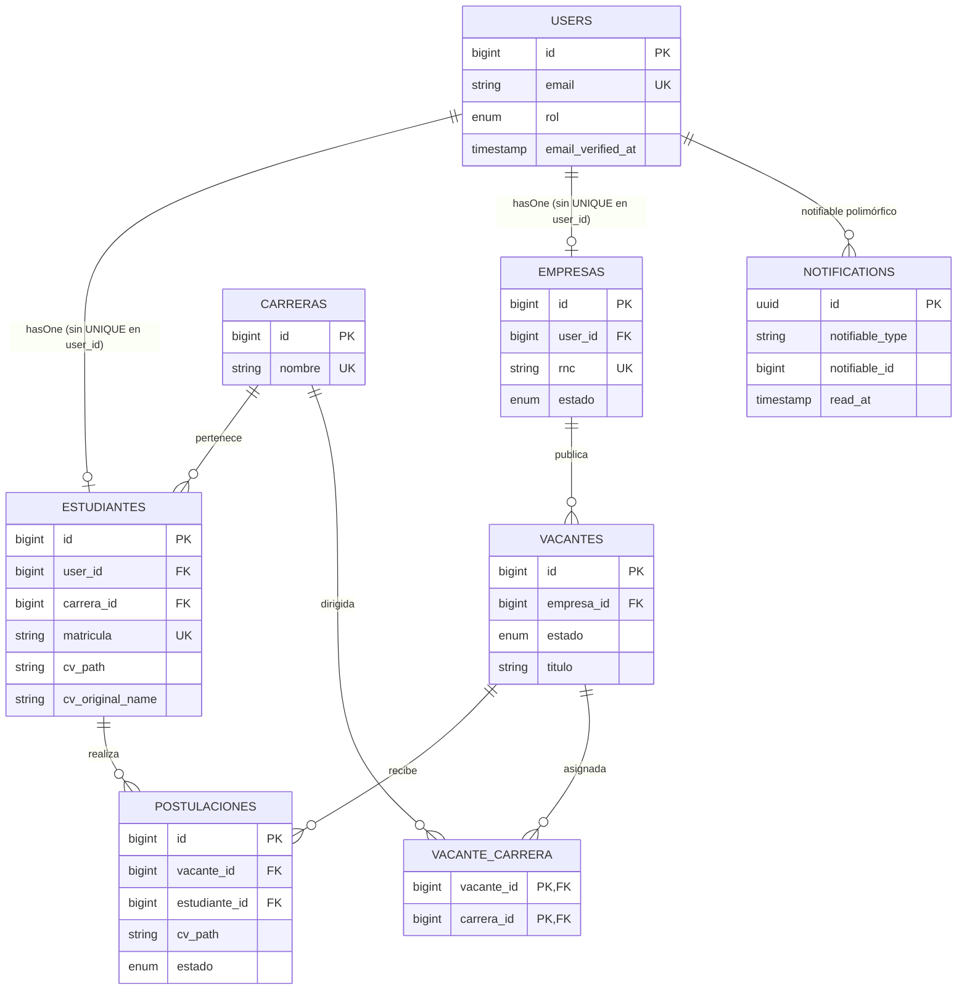
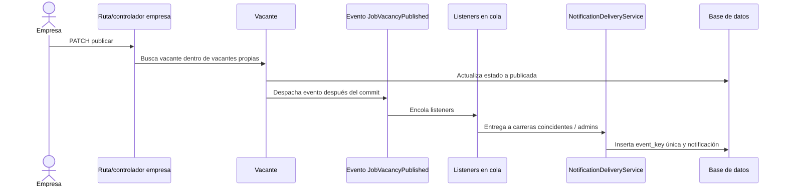
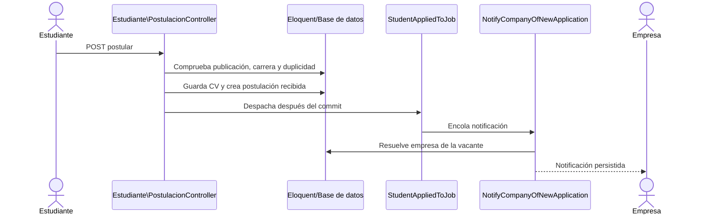
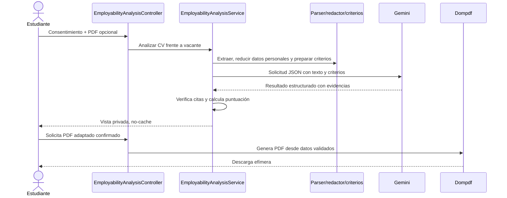

# Documentación técnica — Bolsa de Empleo ITSC

> **Alcance:** análisis estático del código disponible en el espacio de trabajo el 26 de octubre de 2026. No se consultó `.env`, no se inspeccionó una base de datos en ejecución y no se ejecutaron migraciones, seeders, pruebas ni compilaciones. Por ello, las conclusiones describen el código y la configuración versionada, no necesariamente el estado de un despliegue.
>
> **Estado del árbol de trabajo:** hay cambios sin confirmar en `README.md`, el registro de empresas, las notificaciones y sus pruebas, además de dos listeners y un evento nuevos sin seguimiento. Este informe describe el contenido actual del árbol de trabajo y no presupone que esos cambios estén en la rama confirmada.

## Índice

1. [Resumen ejecutivo](#1-resumen-ejecutivo)
2. [Stack tecnológico](#2-stack-tecnológico)
3. [Arquitectura y estructura](#3-arquitectura-y-estructura)
4. [Clases y componentes principales](#4-clases-y-componentes-principales)
5. [Base de datos](#5-base-de-datos)
6. [Funcionalidades y estado](#6-funcionalidades-y-estado)
7. [Rutas, autenticación y autorización](#7-rutas-autenticación-y-autorización)
8. [Flujos de negocio](#8-flujos-de-negocio)
9. [Frontend e interfaz](#9-frontend-e-interfaz)
10. [Dependencias e impacto de cambios](#10-dependencias-e-impacto-de-cambios)
11. [Calidad, pruebas y deuda técnica](#11-calidad-pruebas-y-deuda-técnica)
12. [Preparación para nuevas funcionalidades](#12-preparación-para-nuevas-funcionalidades)
13. [Contexto para futuras sesiones con IA](#13-contexto-para-futuras-sesiones-con-ia)
14. [Recomendaciones y roadmap](#14-recomendaciones-y-roadmap)

## 1. Resumen ejecutivo

### Propósito

El proyecto se presenta como una plataforma web para conectar estudiantes y egresados del Instituto Técnico Superior Comunitario (ITSC) con empresas que publican empleos y pasantías. El nombre y propósito se describen en [`README.md`](./README.md); los flujos funcionales se implementan principalmente en `app/Http/Controllers`, las rutas en `routes/web.php` y las vistas en `resources/views`.

Los perfiles que aparecen en la base de datos y en el middleware son:

- **Administrador (`admin`):** administra carreras, revisa empresas, consulta vacantes y bloquea/activa cuentas de estudiantes y administradores.
- **Empresa (`empresa`):** solicita registro, espera aprobación, crea vacantes y revisa las postulaciones de sus propias vacantes.
- **Estudiante (`estudiante`):** se registra con matrícula y carrera, consulta vacantes dirigidas a su carrera, se postula y gestiona su perfil y CV.

### Flujo general

1. El usuario se registra como estudiante o empresa.
2. El administrador revisa y aprueba las empresas.
3. Una empresa aprobada crea vacantes como borradores, las asocia a carreras y puede publicarlas.
4. Los estudiantes de esas carreras consultan vacantes publicadas y envían postulaciones.
5. La empresa revisa cada postulación y puede avanzar su estado; ciertos cambios generan notificaciones.
6. El estudiante puede solicitar un análisis orientativo de su CV frente a una vacante mediante Gemini y descargar una versión revisada/adaptada en PDF.

### Estado observado

El sistema contiene código para autenticación, CRUD de vacantes, postulaciones, administración, almacenamiento de CV, notificaciones y análisis de empleabilidad. No es posible afirmar que el despliegue esté completamente operativo: no se revisaron las variables de entorno, una base de datos real, servicios de correo, la clave de Gemini ni un worker de colas.

El análisis de pruebas es estático. Hay pruebas automatizadas en `tests/`, pero **no se ejecutaron**, por lo que este informe no declara ninguna prueba como aprobada. No se encontró una carpeta `docs/`; por eso este documento se ubica en la raíz.

## 2. Stack tecnológico

Las versiones exactas de dependencias PHP y Node se tomaron de `composer.lock` y `package-lock.json`. Las restricciones de `composer.json` y `package.json` indican rangos, no garantizan la versión instalada en cada entorno.

| Tecnología | Evidencia y versión declarada/resuelta | Uso en el proyecto |
|---|---|---|
| PHP | `composer.json`: `^8.2` | Backend Laravel. No se consultó el binario PHP activo. |
| Laravel | `^12.0`; lock: `v12.64.0` | MVC, routing, Eloquent, validación, sesiones, colas, cache, notificaciones y eventos. |
| MySQL / SQLite | `README.md` describe MySQL. `config/database.php` ofrece MySQL y SQLite, y usa SQLite como valor por defecto si `DB_CONNECTION` no está definido. | Persistencia relacional; el motor real depende del entorno, que no se inspeccionó. |
| Laravel Breeze | Lock: `v2.4.2` | Punto de partida para autenticación y vistas/controladores de autenticación. |
| PHPUnit | Lock: `11.5.56` | Pruebas unitarias y de funcionalidad, configuradas en `phpunit.xml`. |
| Laravel Dompdf | Lock: `v3.1.2` | Generación del PDF adaptado. |
| Smalot PDF Parser | Lock: `v2.13.1` | Extracción local de texto de PDF. |
| Guzzle | Lock: `7.15.6` | Dependencia HTTP; Gemini se consume mediante `Illuminate\Support\Facades\Http`. |
| Blade | Incluido con Laravel | Plantillas del servidor en `resources/views`. |
| Vite | Lock: `7.3.6` | Compilación y servidor de desarrollo de CSS/JS. |
| Alpine.js | Lock: `3.15.12` | Interacción ligera en el navegador; se utiliza en la campanita de notificaciones. |
| Tailwind CSS | Lock: `3.4.19` | Estilos y utilidades CSS. |
| Axios | Lock: `1.18.1` | Dependencia del frontend; la campanita usa `fetch` directamente. |
| Tailwind Vite plugin | Lock: `@tailwindcss/vite` `4.3.2` | Integración de Tailwind con Vite. Hay una diferencia de versión mayor respecto de `tailwindcss` 3.4.19. |
| PostCSS / Autoprefixer | Declarados en `package.json` | Procesamiento de CSS. `postcss.config.js` configura Tailwind como plugin PostCSS. |

### Dependencias relevantes de Composer

- **Producción:** `laravel/framework`, `laravel/tinker`, `barryvdh/laravel-dompdf`, `guzzlehttp/guzzle`, `smalot/pdfparser`.
- **Desarrollo:** Laravel Breeze, PHPUnit, Mockery, Faker, Pint, Sail y Pail.
- No aparece una librería externa de roles/permisos: los roles son valores de `users.rol` y se verifican con middleware propio.

### Integraciones externas y configuración

- **Gemini:** `GeminiEmployabilityService` realiza una solicitud HTTP a `generativelanguage.googleapis.com` con `GEMINI_API_KEY` y `GEMINI_MODEL`, cargados desde `config/services.php`. No se verificó la configuración efectiva ni se expuso ningún secreto.
- **Correo:** existe una notificación por correo para la aprobación de empresas. `config/mail.php` usa `log` como mailer predeterminado si no se sobrescribe `MAIL_MAILER`; por tanto, un envío real depende del entorno.
- **Colas:** `config/queue.php` usa `database` por defecto. Los listeners de notificaciones son encolables; deben existir las tablas y un worker activo para procesamiento asíncrono.
- **Fuentes:** el layout carga Figtree desde Bunny Fonts; es una dependencia externa de presentación.
- No se encontró un archivo `routes/api.php`; las rutas de negocio examinadas son rutas web.

### Inconsistencia de frontend que requiere validación

Los manifiestos y la configuración combinan `@tailwindcss/vite` 4.x con `tailwindcss` 3.x, `postcss.config.js` con el plugin PostCSS de Tailwind y directivas CSS `@tailwind base/components/utilities`, propias del flujo configurado en la generación 3.x. Es una **inconsistencia confirmada de versiones/configuración**; no se afirma que la compilación falle porque no se ejecutó `npm run build`. Antes de modificar estilos conviene alinear el flujo y comprobar la compilación.

## 3. Arquitectura y estructura

### Patrón observado

La aplicación sigue la arquitectura MVC convencional de Laravel, con responsabilidades de dominio adicionales:

- **Modelos Eloquent:** datos, relaciones y algunas transiciones de estado (`Vacante`, `Postulacion`).
- **Controladores:** reciben solicitudes, validan o invocan validadores, coordinan modelos y devuelven vistas, redirecciones o respuestas.
- **Vistas Blade:** renderizan páginas y formularios.
- **Servicios:** separan la lógica de análisis del CV y la entrega idempotente de notificaciones.
- **Eventos/listeners:** desacoplan notificaciones de acciones como publicar vacantes, recibir postulaciones o aprobar solicitudes.
- **Form Requests:** encapsulan validación/autorización para crear y actualizar vacantes y para autenticar.

No se encontraron repositorios, clases propias en `app/Jobs`, policies ni Gates. Hay lógica de presentación/datos en closures de rutas de dashboard, además de lógica de negocio en controladores y modelos.

### Estructura relevante

```text
app/
  Events/                    Eventos de empresa, vacante y postulación
  Exceptions/                Excepciones de extracción y análisis del CV
  Http/
    Controllers/             Controladores agrupados por perfil
    Middleware/              Middleware de rol
    Requests/                Validaciones/autorización específicas
  Listeners/                 Notificaciones reaccionando a eventos
  Models/                    Modelos Eloquent del dominio
  Notifications/             Notificaciones de Laravel
  Providers/                 Rate limiter de análisis de CV
  Services/                  Entrega de notificaciones y análisis de empleabilidad
resources/
  css/ js/                   Estilos y JavaScript del navegador
  views/                     Plantillas Blade por módulo y perfil
routes/
  web.php                    Rutas de la plataforma
  auth.php                   Rutas de autenticación
database/
  migrations/                Esquema versionado
  seeders/                   Catálogo inicial de carreras y administrador
tests/
  Feature/ Unit/             Pruebas automatizadas
```

### Sesiones, errores y validaciones

- Laravel administra autenticación con sesión y regeneración de sesión al iniciar/cerrar sesión. El driver predeterminado configurado es `database`, salvo cambio en el entorno.
- `EnsureRol` rechaza solicitudes con HTTP 403 cuando el rol autenticado no coincide.
- Se usan validaciones de Laravel en controladores y Form Requests; las acciones de estado capturan `RuntimeException` para devolver mensajes al usuario.
- `CvExtractionException` y `EmployabilityAnalysisException` representan fallos esperables del análisis; en el endpoint de análisis se convierten en mensaje de sesión y, para descarga, en respuesta HTTP 422.
- No se configuraron manejadores personalizados en `bootstrap/app.php`; el manejo restante depende de Laravel.

## 4. Clases y componentes principales

### Modelos

| Clase | Campos/propiedades relevantes | Métodos principales, relaciones y dependencias |
|---|---|---|
| `User` — `app/Models/User.php` | `name`, `email`, `password`, `rol`; oculta `password` y `remember_token`; cast de contraseña `hashed` y `email_verified_at` a fecha. | `estudiante()`, `empresa()` y `sendPasswordResetNotification()`. Usa autenticación Eloquent, `Notifiable` y el canal de notificaciones. |
| `Estudiante` — `app/Models/Estudiante.php` | `user_id`, `carrera_id`, `matricula`, `tipo`, `telefono`, `cv_path`, `cv_original_name`, `resumen`. | `user()`, `carrera()`, `postulaciones()`. Depende de almacenamiento para el CV; el controlador/servicios gestionan archivos. |
| `Empresa` — `app/Models/Empresa.php` | `user_id`, `nombre_empresa`, `rnc`, `sector`, `descripcion`, `telefono`, `sitio_web`, `logo_path`, `estado`. | `user()`, `vacantes()`. El estado controla aprobación y acceso a creación de vacantes. |
| `Carrera` — `app/Models/Carrera.php` | `nombre`. | `estudiantes()`, `vacantes()`. Comparte la pivot `vacante_carrera`. |
| `Vacante` — `app/Models/Vacante.php` | `empresa_id`, título/descripción/requisitos, tipo, modalidad, ubicación, salarios, fecha de cierre y estado; cast de fecha y salarios. | `empresa()`, `carreras()`, `postulaciones()`, `publicar()`, `cerrar()`. Publicar emite `JobVacancyPublished`; operaciones invocadas por controladores de empresa. |
| `Postulacion` — `app/Models/Postulacion.php` | `vacante_id`, `estudiante_id`, carta, `cv_path`, estado. | `vacante()`, `estudiante()`, `marcarEnRevision()`, `aceptar()`, `rechazar()`. Las transiciones emiten `ApplicationStatusChanged`. |

### Controladores principales

| Grupo/clase | Métodos/acciones principales | Responsabilidad y dependencias |
|---|---|
| `Auth\RegisteredUserController` | `create`, `store` | Registro estudiantil; crea `User` y `Estudiante` en transacción y autentica al nuevo usuario. |
| `Auth\EmpresaRegisterController` | `create`, `store` | Registro transaccional de empresa pendiente; despacha `CompanySubmittedForApproval`. |
| `Auth\AuthenticatedSessionController` | `create`, `store`, `destroy` | Inicio/cierre de sesión; rechaza empresas no aprobadas y usuarios con `email_verified_at` nulo. |
| `Empresa\VacanteController` | `index`, `create`, `store`, `show`, `edit`, `update`, `destroy`, `publicar`, `cerrar` | CRUD, filtros, asociaciones de carrera y ciclo de vida de vacantes propias; usa `StoreVacanteRequest`/`UpdateVacanteRequest`. |
| `Empresa\PostulacionController` | `index`, `cv`, `enRevision`, `aceptar`, `rechazar`, `propia` | Lista postulaciones de vacantes propias, sirve CVs y cambia estados; `propia()` restringe por empresa autenticada. |
| `Estudiante\VacanteController` | `index`, `show` | Lista/detalla vacantes publicadas de la carrera del estudiante; verifica postulación y disponibilidad del CV. |
| `Estudiante\PostulacionController` | `index`, `store` | Historial filtrable y creación; verifica carrera, publicación, archivo y duplicidad; despacha evento de postulación. |
| `Estudiante\PerfilController` | `edit`, `cv`, `update`, `destroyCv`, `safeOriginalName` | Perfil y operaciones de CV privado/legacy; normaliza el nombre original del archivo. |
| `Estudiante\EmployabilityAnalysisController` | `analyze`, `downloadAdaptedCv`, `profileCvContents`, `sectionValidationRules` | Consentimiento, validación de acceso, cache temporal, validación de datos y PDF; depende de servicios de empleabilidad y Dompdf. |
| `Admin\EmpresaController` | `index`, `aprobar`, `bloquear`, `rechazar` | Lista y cambia estado de empresas; aprobación emite notificación por correo. |
| `Admin\CarreraController` | `index`, `store`, `update`, `destroy` | Administración del catálogo; bloquea eliminación de carreras relacionadas. |
| `Admin\UsuarioController` | `index`, `bloquear`, `activar` | Filtra usuarios no empresariales y modifica su estado indirectamente mediante `email_verified_at`. |
| `Admin\VacanteController` | `index` | Lista vacantes publicadas con filtros; no implementa edición de vacantes. |
| `NotificationController` | `index`, `feed`, `markRead`, `markAllRead`, `open`, `findOwnedNotification`, `destination` | Historial/feed y lectura; cada consulta se limita al usuario autenticado y las redirecciones revalidan recursos. |
| `ProfileController` | `edit`, `update`, `destroy` | Perfil general de Breeze; cambiar email pone la marca de verificación a nulo. |

### Servicios, eventos, listeners y otros

| Componente | Métodos/campos principales | Responsabilidad y dependencias |
|---|---|
| `EmployabilityAnalysisService` | `analyze`, `validateAdaptationSubmission` | Coordina extracción, anonimización, criterios, Gemini y validación de evidencia; calcula puntuación. Inyecta los cuatro servicios del análisis. |
| `CvTextExtractor` | `extractFromStorage`, `extract` | Extrae texto localmente; máximo 2 MiB, 50 páginas y 60 000 caracteres; no incorpora OCR. |
| `CvPrivacyRedactor` | `redact` | Omite nombre, email, matrícula y patrones de teléfono/correo antes del envío externo. |
| `VacancyCriteriaBuilder` | `build` | Divide requisitos/descripción en criterios únicos; límite de 30. |
| `GeminiEmployabilityService` | `analyze`, `responseSchema` | Configura prompt/esquema JSON, invoca endpoint externo y gestiona errores HTTP/JSON. |
| `NotificationDeliveryService` | `sendOnce(User, eventKey, data)` | Inserta clave única en `notification_deliveries` y persiste notificación si la clave es nueva. |
| Eventos | Propiedades de IDs y estados; `dispatch` | `CompanySubmittedForApproval`, `JobVacancyPublished`, `StudentAppliedToJob`, `ApplicationStatusChanged`; declarados para esperar al commit. |
| Listeners | `handle(event)`; `tries = 3` | Notifican administradores, estudiantes de carreras afectadas, empresas y estudiantes; se encolan tras commit. |
| `EnsureRol` | `handle(Request, Closure, rol)` | Devuelve 403 si el usuario autenticado no coincide con el rol esperado. |
| Form Requests | `authorize`, `rules` | `StoreVacanteRequest` exige empresa aprobada y valida campos/carreras; `UpdateVacanteRequest` hereda reglas; `LoginRequest` valida credenciales y limita intentos. |

No se identificaron clases propias de Job, repositorio, Policy, Gate ni un módulo API.

## 5. Base de datos

### Tablas de negocio observadas en migraciones

| Tabla | Campos principales / reglas verificadas |
|---|---|
| `users` | `id`, `name`, `email` único, `email_verified_at`, contraseña, `rol` enum (`admin`, `empresa`, `estudiante`), remember token y timestamps. |
| `estudiantes` | `user_id` FK con borrado en cascada, `carrera_id` FK, matrícula única, tipo enum (`estudiante`, `egresado`), teléfono, CV, resumen y timestamps. Migraciones posteriores agregan `cv_original_name`. |
| `empresas` | `user_id` FK con borrado en cascada, nombre, RNC único, sector, descripción, teléfono, web, logo y estado enum (`pendiente`, `aprobada`, `rechazada`, `bloqueada`). |
| `carreras` | `id`, nombre único y timestamps. |
| `vacantes` | `empresa_id` FK con cascada, título, descripción, requisitos, tipo de empleo, modalidad, ubicación, rango salarial, fecha de cierre y estado enum (`borrador`, `publicada`, `cerrada`). |
| `vacante_carrera` | Tabla pivot con FKs a vacante/carrera, borrado en cascada y clave primaria compuesta `(vacante_id, carrera_id)`. |
| `postulaciones` | FKs a vacante y estudiante, carta, estado enum (`recibida`, `en_revision`, `aceptada`, `rechazada`), timestamps y restricción única `(vacante_id, estudiante_id)`. Una migración posterior agrega `cv_path`. |
| `notifications` | Notificaciones de Laravel: UUID como PK, relación polimórfica `notifiable`, JSON/texto de datos, fecha de lectura y timestamps. |
| `notification_deliveries` | `event_key` único y timestamps; sirve para evitar repetir la entrega ante reintentos. |

### Tablas de infraestructura creadas por migraciones

Las migraciones también crean `sessions`, `password_reset_tokens`, `cache`, `cache_locks`, `jobs`, `job_batches` y `failed_jobs`. Sirven a componentes de Laravel y no representan entidades de negocio.

### Relaciones Eloquent y restricciones

- `User` uno-a-uno con `Estudiante`/`Empresa` según los métodos `hasOne`; ambos perfiles usan `belongsTo(User)`.
- `Estudiante` pertenece a `Carrera`; una carrera tiene muchos estudiantes.
- `Empresa` tiene muchas vacantes; una vacante pertenece a una empresa.
- `Vacante` y `Carrera` son muchos-a-muchos por `vacante_carrera`.
- `Vacante` y `Estudiante` se vinculan por `Postulacion`, con unicidad de pareja en base de datos.
- Las postulaciones y vacantes dependen de FKs con cascada según las migraciones; la FK de `estudiantes.carrera_id` no declara cascada.
- **Diferencia confirmada de cardinalidad:** los modelos declaran `User::hasOne(Estudiante/Empresa)`, pero las migraciones no marcan `estudiantes.user_id` ni `empresas.user_id` como únicos. La aplicación crea perfiles mediante `hasOne`, aunque la base de datos no impide que existan varios registros para un mismo usuario.
- La tabla `sessions.user_id` tiene índice, pero la migración no define una FK.

### Diagrama entidad-relación

El diagrama representa las relaciones de negocio corroboradas por los modelos y las migraciones. `1 — 0..1` para perfiles expresa la intención Eloquent, no una garantía de unicidad actualmente impuesta por la base de datos.



### Límite de verificación del esquema

El documento describe las migraciones presentes; no certifica que hayan sido aplicadas a la base de datos real. El archivo `.env` y la base de datos no se inspeccionaron. La configuración admite más de un motor y el README recomienda MySQL, mientras que el valor por defecto versionado en `config/database.php` es SQLite.

## 6. Funcionalidades y estado

**Criterio de estado:** “Implementada” significa que se encontró un flujo de ruta/controlador/modelo o vista correspondiente. Se indica si existe una prueba asociada, pero, dado que no se ejecutaron pruebas, ninguna se declara verificada/pasada.

| Módulo/perfil | Funcionalidad confirmada en código | Estado y evidencia de pruebas |
|---|---|---|
| Autenticación | Registro de estudiante con matrícula/carrera; registro de empresa en estado pendiente; inicio/cierre de sesión; recuperación/cambio de contraseña y rutas de verificación de correo de Breeze. | Implementada. Hay pruebas de autenticación/registro en `tests/Feature/Auth`; no ejecutadas. El `User` no implementa `MustVerifyEmail` y los dos flujos de registro asignan `email_verified_at` al crear la cuenta. |
| Empresas | Listar y filtrar vacantes propias; crear, editar, mostrar y borrar; publicar y cerrar con transición de estado; listar postulaciones propias, leer CV y cambiar estado. | Implementada. Hay pruebas de filtros de vacantes y CV/postulaciones; no ejecutadas. |
| Estudiantes | Explorar vacantes publicadas para su carrera, ver detalles, cargar/descargar/eliminar CV, postularse y consultar/filtrar postulaciones. | Implementada. Hay pruebas `VacanteListingFiltersTest` y `StudentCvTest`; no ejecutadas. La tabla limita duplicados con índice único. |
| Administración | Aprobar, bloquear o rechazar empresas; mantener carreras; listar vacantes publicadas; bloquear/activar usuarios no empresariales. Dashboard con contadores. | Implementada parcialmente respecto de una administración de vacantes completa: la ruta actual solo lista vacantes; no se halló edición/aprobación administrativa de vacantes. Hay pruebas para filtros y vacantes de administrador, no ejecutadas. |
| Notificaciones | Notificaciones persistentes, feed para campana, historial, lectura individual/masiva y redirección condicionada por propietario/estado del recurso. Eventos encolables para empresas, estudiantes y administradores. | Implementada en el código actual. Hay pruebas `NotificationSystemTest` y `NotificationPersistenceTest`; no ejecutadas. Algunos archivos relacionados están sin confirmar en el árbol de trabajo. |
| Asistente de empleabilidad | Consentimiento, extracción local del PDF, anonimización, comparación de requisitos vía Gemini, evidencias verificadas y descarga PDF adaptada. | Implementada; depende de configurar Gemini y de un PDF extraíble. Hay pruebas de análisis/CV y extractor; no ejecutadas. |
| Email de aprobación | Notificación por email al aprobar empresa. | Implementada en código. Entrega real depende del mailer configurado; el valor predeterminado versionado es `log`. No se ejecutó un envío. |

No se encontró una integración de OCR, historial persistente de análisis, aplicación móvil/API REST, carga de logo de empresa desde un flujo de perfil, ni un panel para modificar vacantes como administrador. Esto describe lo que no se encontró en las rutas/clases revisadas; no implica que sean requisitos pendientes acordados.

## 7. Rutas, autenticación y autorización

Las rutas de negocio están en `routes/web.php`; las rutas de autenticación están en `routes/auth.php`. Los grupos usan el middleware `auth` y el middleware de rol registrado como alias `rol` en `bootstrap/app.php`.

### Grupos principales

| Prefijo / nombre | Middleware | Operaciones relevantes |
|---|---|---|
| Público | Ninguno | `GET /` muestra bienvenida. Registro, login y recuperación bajo middleware `guest` en `routes/auth.php`. |
| `/dashboard` | `auth` | Redirige por `users.rol` al dashboard del perfil. |
| Cuenta y notificaciones | `auth` | Perfil genérico, feed/historial y lectura de notificaciones. |
| `/admin` (`admin.*`) | `auth`, `rol:admin` | Dashboards y operaciones de empresa, vacantes, carreras y usuarios. |
| `/empresa` (`empresa.*`) | `auth`, `rol:empresa` | Dashboard, resource limitado de vacantes, postulación/CV y transiciones de postulación. |
| `/estudiante` (`estudiante.*`) | `auth`, `rol:estudiante` | Dashboard, vacantes, postulación, perfil/CV y análisis de empleabilidad. |

### Endpoints principales y controladores

| HTTP | Ruta | Acción |
|---|---|---|
| `GET` | `/`, `/dashboard` | Vista de bienvenida; redirección por rol. |
| `GET/POST` | `/register`, `/register/empresa`, `/login`, `/forgot-password`, `/reset-password/{token}` | `RegisteredUserController`, `EmpresaRegisterController`, `AuthenticatedSessionController` y controladores Breeze de autenticación. |
| `GET/POST` | `/verify-email`, `/verify-email/{id}/{hash}`, `/email/verification-notification`, `/confirm-password`, `/password`, `/logout` | Controladores de verificación, confirmación, contraseña y sesión de Breeze. |
| `GET/PATCH/DELETE` | `/profile` | `ProfileController::edit/update/destroy`. |
| `GET/PATCH` | `/notifications`, `/notifications/feed`, `/notifications/read-all`, `/notifications/{uuid}/read`, `/notifications/{uuid}/open` | `NotificationController`; lectura por usuario autenticado. |
| `GET/PATCH/POST/DELETE` | `/admin/dashboard`, `/admin/empresas`, `/admin/empresas/{id}/aprobar|bloquear|rechazar`, `/admin/vacantes`, `/admin/carreras`, `/admin/carreras/{id}`, `/admin/usuarios`, `/admin/usuarios/{id}/bloquear|activar` | Closures para dashboard; `Admin\EmpresaController`, `VacanteController`, `CarreraController`, `UsuarioController`. Solo admin. |
| `GET/POST/PUT/PATCH/DELETE` | `/empresa/vacantes` y `/empresa/vacantes/{id}` | `Empresa\VacanteController` mediante resource limitado a index/create/store/show/edit/update/destroy. Solo empresa. |
| `PATCH/GET` | `/empresa/vacantes/{id}/publicar`, `/empresa/vacantes/{id}/cerrar`, `/empresa/vacantes/{id}/postulaciones`, `/empresa/postulaciones/{id}/cv` | `Empresa\VacanteController` y `Empresa\PostulacionController`. Solo empresa; consultas limitadas a propiedad. |
| `PATCH` | `/empresa/postulaciones/{id}/en-revision|aceptar|rechazar` | `Empresa\PostulacionController`. Solo empresa propietaria. |
| `GET` | `/estudiante/dashboard`, `/estudiante/vacantes`, `/estudiante/vacantes/{id}`, `/estudiante/postulaciones`, `/estudiante/perfil`, `/estudiante/perfil/cv` | Closures de dashboard y controladores de vacantes, postulaciones y perfil. Solo estudiante. |
| `POST/DELETE` | `/estudiante/vacantes/{id}/postular`, `/estudiante/vacantes/{id}/analisis-cv`, `/estudiante/vacantes/{id}/cv-adaptado`, `/estudiante/perfil`, `/estudiante/perfil/cv` | `Estudiante\PostulacionController`, `EmployabilityAnalysisController` y `PerfilController`. Análisis/descarga sujetos al rate limiter. |

Las rutas del análisis y descarga del CV tienen `throttle:cv-analysis`. `AppServiceProvider` configura cinco solicitudes por hora y clave por usuario autenticado (o IP). Como el mismo middleware protege ambos endpoints, el límite se comparte entre análisis y descarga, no únicamente entre análisis.

### Controles de acceso observados

- El middleware verifica perfil/rol.
- Los controladores de empresa consultan vacantes a través de `auth()->user()->empresa->vacantes()` y buscan postulaciones solo dentro de vacantes de esa empresa.
- Las acciones de CV de postulaciones verifican que la vacante pertenezca a la empresa autenticada.
- La aplicación estudiantil exige vacante publicada y carrera coincidente antes de crear postulación. El listado ya filtra por carrera.
- `NotificationController` consulta notificaciones mediante la relación del usuario y resuelve destinos revalidando rol, propiedad y disponibilidad del recurso.
- La creación de vacantes exige aprobación empresarial tanto en el controlador/form request como en el grupo de rutas.
- No hay Policies/Gates propios; la autorización queda en middleware y en consultas/scopes de controladores.

### Observaciones de autenticación

- `AuthenticatedSessionController` bloquea empresas que no estén aprobadas.
- La aplicación reutiliza `email_verified_at` como indicador de cuenta bloqueada en el login y en `Admin\UsuarioController`; no existe un campo `estado` separado para usuarios.
- Las rutas de verificación de correo están definidas, pero `User` no implementa `MustVerifyEmail`; además, el registro marca el correo como verificado. La relación entre “verificación real” y “bloqueo” debe aclararse antes de ampliar autenticación.
- `ProfileController::update()` pone `email_verified_at` en `null` cuando cambia el correo. Como `AuthenticatedSessionController` rechaza a cualquier usuario con ese campo nulo y no se encontró un flujo activo que lo vuelva a verificar, cambiar el email puede impedir iniciar sesión de nuevo. Es un efecto observable del código, aunque no se probó en ejecución.
- El seed de administrador contiene una contraseña predeterminada codificada en el seeder. No se reproduce aquí; debe tratarse como valor de desarrollo y no utilizarse sin rotación en un entorno real.

## 8. Flujos de negocio

### Registro y aprobación empresarial

1. `POST /register/empresa` valida nombre, email, contraseña, nombre de empresa, RNC y teléfono.
2. `EmpresaRegisterController` crea `User` y `Empresa` dentro de una transacción; la empresa nace `pendiente`.
3. Despacha `CompanySubmittedForApproval`; el listener `NotifyAdminsOfPendingCompany` notifica a los administradores y usa una clave de idempotencia.
4. Un administrador usa `PATCH /admin/empresas/{empresa}/aprobar`.
5. `Admin\EmpresaController` cambia estado, envía `EmpresaAprobadaNotification` por correo y marca el usuario verificado si aún no lo estaba.
6. El login rechaza empresas pendientes, rechazadas o bloqueadas; las aprobadas pueden entrar.

El listener de empresa pendiente y el evento aparecen en el árbol de trabajo actual; algunos de esos archivos están sin seguimiento en Git, así que su presencia en este análisis no significa que estén confirmados en el repositorio.

### Publicación y notificación de vacante

1. Una empresa aprobada crea una vacante mediante `POST /empresa/vacantes`; se guarda como `borrador` y se sincronizan sus carreras.
2. `PATCH /empresa/vacantes/{vacante}/publicar` verifica que la vacante pertenezca a la empresa.
3. `Vacante::publicar()` solo permite transición desde `borrador`, actualiza el estado y despacha `JobVacancyPublished`.
4. Los listeners notifican a estudiantes cuya carrera está asociada y a administradores. La clave de `notification_deliveries.event_key` evita repetir una entrega por reintento.



### Postulación y evaluación

1. El estudiante envía `POST /estudiante/vacantes/{vacante}/postular`.
2. El controlador busca una vacante publicada y confirma que esté dirigida a su carrera.
3. Valida carta y CV PDF (máximo 2 MiB); si no adjunta uno, copia el CV del perfil al almacenamiento privado de la postulación.
4. Comprueba duplicidad y crea `Postulacion` con estado `recibida`; la base de datos también exige unicidad de vacante/estudiante.
5. Despacha `StudentAppliedToJob`; el listener notifica a la empresa propietaria.
6. La empresa marca `en_revision`, `aceptada` o `rechazada` mediante endpoints separados. El modelo restringe las transiciones y emite `ApplicationStatusChanged`; el listener notifica al estudiante para los estados finales.



### Análisis de CV

1. El estudiante solicita `POST /estudiante/vacantes/{vacante}/analisis-cv`, acepta consentimiento y puede adjuntar un PDF alternativo.
2. Se valida vacante publicada y carrera coincidente; se aplica el límite de solicitudes.
3. `EmployabilityAnalysisService` extrae texto, anonimiza identificadores conocidos y construye criterios desde requisitos/descripción.
4. `GeminiEmployabilityService` envía el CV y datos de vacante a Gemini. El servicio verifica que citas devueltas existan literalmente en el texto; el porcentaje pondera coincidencias directas como 1 y relacionadas como 0.5.
5. La página muestra el resultado sin persistir historial. Si el usuario subió un archivo temporal, su contenido se conserva codificado en cache de archivo por hasta 30 minutos para la descarga.
6. Al descargar, el backend valida el fingerprint, las citas/evidencias y el consentimiento de revisión, genera PDF con Dompdf y elimina la copia temporal de cache cuando corresponde.



La existencia de un API key funcional, worker, correo y conexión a base de datos no pudo comprobarse en este análisis.

## 9. Frontend e interfaz

- **Plantillas:** Blade; vistas organizadas por `admin`, `empresa`, `estudiante`, `auth`, `profile` y `notifications`.
- **Layouts/componentes:** `layouts/app.blade.php`, `layouts/navigation.blade.php` y componentes Blade de botones, formularios, navegación y campana.
- **Vistas de módulo:** dashboards por perfil, índices de vacantes/postulaciones, formularios de vacante, perfil y análisis de CV. La plantilla `estudiante/vacantes/adapted-cv.blade.php` es la salida para Dompdf.
- **JavaScript:** `resources/js/app.js` inicializa Alpine. La campana consulta `notifications.feed` mediante `fetch`, refresca cada 30 segundos si la pestaña está visible y permite marcar todas como leídas. No se encontró un frontend SPA.
- **Formularios:** envían solicitudes web tradicionales y se benefician de validación/errores de Laravel. En la vista de análisis el estudiante puede revisar y editar el borrador antes de descargar el PDF.
- **Compilación:** Vite toma `resources/css/app.css` y `resources/js/app.js`; el resultado se referencia con `@vite`.
- **Peticiones asíncronas examinadas:** `fetch` se usa para la campana de notificaciones; no se encontró una API REST dedicada.

## 10. Dependencias e impacto de cambios

### Componentes de mayor acoplamiento

- `User` afecta autenticación, rol, perfil, notificaciones y acceso a los módulos.
- `Vacante` se comparte entre empresa, administración, estudiantes, postulaciones y análisis de empleabilidad.
- `Estudiante` / `Carrera` conectan elegibilidad, listados, CV y destinatarios de notificaciones.
- `Postulacion` conecta ambos perfiles, estado, almacenamiento de CV y notificaciones.
- `routes/web.php` define las fronteras de acceso y nombres usados por Blade y redirecciones.

### Matriz de impacto

| Componente | Responsabilidad | Dependencias | Impacto potencial de modificarlo | Riesgo |
|---|---|---|---|---|
| `User` / rol / `email_verified_at` | Autenticación, identidad, bloqueo y rol | Middleware, login, dashboards, perfil, notificaciones | Puede impedir login, cambiar disponibilidad de rutas o confundir bloqueo con verificación de correo. | **Alto** — el estado de cuenta se deriva del campo de verificación. |
| `Vacante` y estados | Ciclo de vida y oferta | Empresa, estudiante, admin, eventos, notificaciones, Gemini | Cambiar estados o relaciones afecta publicación, listados, postulación, análisis y avisos. | **Alto** — entidad central en varios flujos. |
| `Estudiante` / CV | Carrera, perfil y documentos | Postulación, descarga, Gemini, almacenamiento, PDF | Cambios de ruta/disk o campos afectan solicitudes y privacidad del CV. | **Alto** — documento se consume en más de un proceso. |
| `Postulacion` | Vínculo estudiante-vacante y evaluación | Vacante, estudiante, CV, listeners y notificaciones | Alterar estados/transiciones afecta elegibilidad y mensajes a ambas partes. | **Alto** — flujo con restricción única y eventos. |
| `Carrera` / `vacante_carrera` | Catálogo y segmentación | Estudiantes, filtros, publicación y alertas | Cambios en IDs/relaciones alteran quién ve y recibe una vacante. | **Alto** — condición de acceso y distribución. |
| `routes/web.php` y `EnsureRol` | Superficie HTTP y autorización | Controladores, Blade, middleware `auth` | Puede exponer operaciones, romper nombres de ruta o permitir perfil incorrecto si se quita protección. | **Alto** — frontera de seguridad de todos los módulos. |
| `EmployabilityAnalysisService` y subservicios | Análisis de CV y datos externos | Gemini, parser, redactor, criterios, validadores, PDF | Cambios pueden alterar datos enviados, evidencia, puntuación o límites de carga. | **Alto** — procesa datos personales y depende de servicio externo. |
| Eventos/listeners/entrega | Notificaciones desacopladas e idempotentes | Queue worker, tablas de notificación e idempotencia | Cambiar clave/evento puede duplicar o perder avisos y enlaces. | **Medio-alto** — requiere consistencia entre evento, listener y destino. |
| Migraciones de perfiles | Modelo relacional | Eloquent y formularios de registro | Cambios incompatibles pueden dejar cuentas/perfiles huérfanos o romper despliegues. | **Alto** — esquema persistente y datos existentes. |
| Vistas Blade / Tailwind / Vite | Presentación y captura de acciones | Rutas nombradas, validaciones y assets | Puede romper formularios o estilos sin cambiar el backend. | **Medio** — alcance normalmente de interfaz, pero configuración CSS presenta versiones mixtas. |
| `NotificationController` | Feed, lectura y redirección | `User`, modelo de notificación, recursos y rutas | Cambios en validación/destinos pueden llevar a navegación incorrecta o marcar avisos ajenos. | **Medio-alto** — verifica pertenencia y disponibilidad. |

## 11. Calidad, pruebas y deuda técnica

### Hechos verificados

1. **Roles manuales y autorización distribuida.** La protección combina middleware de rol con consultas en controladores; no hay Policies/Gates propios.
2. **Cardinalidad no asegurada por la BD.** Los métodos `hasOne` entre usuario y perfil no están respaldados por índices `UNIQUE` en `user_id`.
3. **Campo con doble propósito.** `email_verified_at` se establece al registrar y también se usa para representar bloqueo de cuenta. Esto mezcla verificación y estado administrativo.
4. **Cambio de correo puede causar bloqueo de acceso.** `ProfileController` borra `email_verified_at` al modificarlo y el login rechaza ese valor nulo; no se encontró un flujo de verificación efectivo que lo restablezca.
5. **Límite compartido entre dos acciones.** Tanto analizar como descargar CV usan `throttle:cv-analysis`; el proveedor define cinco solicitudes por hora por usuario.
6. **Versiones frontend mezcladas.** Tailwind Vite plugin es 4.x mientras Tailwind CSS y la sintaxis/configuración corresponden a 3.x. La compilación no fue validada.
7. **Diferencia de motor predeterminado.** README describe MySQL, pero `config/database.php` cae a SQLite si no se establece la variable de conexión.
8. **Transiciones modeladas explícitamente.** Vacantes y postulaciones validan estados antes de actualizar y lanzar eventos.
9. **Protecciones de CV presentes.** Se valida MIME/extensión declarada por Laravel, tamaño; el extractor verifica firma PDF, páginas y longitud, y la descarga de CV de postulación valida propiedad empresarial.
10. **La lista de carreras no se borra si tiene asociaciones.** `CarreraController` verifica conteos de estudiantes y vacantes antes de eliminar.
11. **La mayoría de listados principales pagina y usa eager loading** (`with`, `withCount`) en las consultas revisadas.

### Riesgos potenciales (no confirmados como fallos)

- La comprobación de duplicidad de postulación en el controlador y el índice único protegen el caso normal; dos solicitudes concurrentes pueden competir y provocar una excepción por la restricción, que no se convierte explícitamente en un mensaje de negocio.
- El archivo de CV se escribe y la postulación se guarda en pasos separados. Un error en la base de datos tras guardar el archivo podría dejar un documento sin referencia; una política de compensación/limpieza debe evaluarse.
- La descarga del CV adaptado comprueba que la vacante sea de la carrera, pero no aplica el mismo filtro `estado = publicada` que aplica el endpoint de análisis. El impacto depende de cómo se acceda a esa ruta y puede ser una inconsistencia funcional frente al ciclo de publicación.
- No se observaron índices dedicados para campos de búsqueda de texto o filtros recurrentes; es un riesgo de rendimiento al crecer el volumen, no evidencia de lentitud actual.
- Los listeners requieren que el entorno ejecute un worker cuando la conexión de cola es asíncrona; sin él, las notificaciones pueden acumularse.
- La puntuación depende de la respuesta semántica de un modelo externo, aunque las citas y el cálculo numérico se validan en backend; no constituye una evaluación determinista de contratación.

### Pruebas automatizadas presentes

`phpunit.xml` configura entorno de prueba con SQLite en memoria, correo en `array`, cola `sync`, cache y sesión `array`. Existen, entre otras:

- `tests/Feature/Auth/*`: autenticación, registro, contraseña y verificación.
- `tests/Feature/VacanteListingFiltersTest.php`: filtros por perfil.
- `tests/Feature/StudentCvTest.php`: carga/descarga, reemplazo/borrado y acceso empresarial a CV.
- `tests/Feature/EmployabilityAnalysisTest.php` y `tests/Unit/CvTextExtractorTest.php`: análisis con HTTP fake, consentimiento, privacidad, extracción y errores.
- `tests/Feature/NotificationSystemTest.php` y `NotificationPersistenceTest.php`: creación, entrega, persistencia e idempotencia.
- `tests/Feature/AdminVacantesTest.php`, `ProfileTest.php` y pruebas de ejemplo.

**No se ejecutó `php artisan test` ni ningún comando de build.** Por tanto, la existencia de las pruebas está comprobada por los archivos; su estado de ejecución, cobertura completa y resultado son desconocidos.

### Recomendaciones de calidad

- Separar explícitamente el estado de bloqueo de la verificación de correo.
- Respaldar las relaciones uno-a-uno con unicidad en base de datos si esa cardinalidad es requisito.
- Centralizar reglas de autorización relevantes en Policies si aumenta el número de rutas/actores.
- Alinear versiones de Tailwind y validar el build.
- Añadir manejo controlado de duplicados concurrentes y compensación ante fallos de almacenamiento.
- Mantener pruebas de transiciones de estado, permisos entre propietarios, migración y entrega idempotente.

## 12. Preparación para nuevas funcionalidades

1. **Reutilizar modelos y relaciones:** `User`, `Estudiante`, `Empresa`, `Carrera`, `Vacante` y `Postulacion` ya expresan el dominio principal. Preferir sus relaciones Eloquent a consultas manuales no acotadas.
2. **Ubicar la lógica según responsabilidad:** modelos para invariantes de estado pequeñas ya existentes; `app/Services` para procesos coordinados; Form Requests para reglas/autorización HTTP; controladores por perfil en `app/Http/Controllers/{Admin,Empresa,Estudiante}`.
3. **Integrar eventos:** para nuevas notificaciones, emitir evento después de un cambio confirmado, añadir listener en `app/Listeners`, persistir usando `NotificationDeliveryService` si necesita idempotencia y cubrirlo con prueba.
4. **Cambios de datos:** añadir una migración nueva; revisar claves foráneas, unicidad y estrategias de borrado. No asumir que una migración está aplicada solo porque existe.
5. **Cambios de interfaz:** crear/modificar Blade en el directorio del perfil, preservar nombres de ruta y protección CSRF, y verificar la configuración Tailwind/Vite.
6. **Archivos personales:** mantener CVs en disco privado, validar tipo/tamaño, limitar acceso mediante la relación del usuario y revisar copias/eliminaciones en todos los flujos que usan el archivo.
7. **Pruebas recomendadas antes/después:** prueba de rol/propietario; reglas de validación; transiciones; regresión por carrera; almacenamiento real simulado; eventos/listeners; fake del HTTP externo; renderizado de vista/PDF; prueba de migración en el motor objetivo.
8. **Revisar dependencias:** antes de incorporar una librería nueva, comprobar compatibilidad de las versiones actuales y dependencias ya disponibles.

## 13. Contexto para futuras sesiones con IA

> Bolsa de Empleo ITSC es una aplicación Laravel 12 / PHP 8.2 con vistas Blade y perfiles `admin`, `empresa` y `estudiante`. Los roles se guardan en `users.rol`; `EnsureRol` protege grupos de rutas en `routes/web.php`. Los modelos principales son `User`, `Estudiante`, `Empresa`, `Carrera`, `Vacante` y `Postulacion`.
>
> Una empresa recién registrada queda `pendiente`; solo una empresa aprobada crea vacantes. Las vacantes siguen `borrador → publicada → cerrada` y se asocian a carreras mediante `vacante_carrera`. Estudiantes solo listan vacantes publicadas de su carrera y una pareja vacante/estudiante no puede repetirse por índice único en `postulaciones`. La empresa propietaria evalúa postulaciones con estados `recibida`, `en_revision`, `aceptada`, `rechazada`.
>
> El CV del perfil se guarda en el disk `local` en el código actual y se puede leer desde `public` como compatibilidad con archivos antiguos. El CV de postulación se copia/guarda aparte. `EmployabilityAnalysisService` coordina `CvTextExtractor`, `CvPrivacyRedactor`, `VacancyCriteriaBuilder` y `GeminiEmployabilityService`; el análisis envía el texto a Gemini, requiere consentimiento y verifica citas en backend. La versión PDF se produce con Dompdf y no se guarda como historial.
>
> Los eventos/listeners de notificaciones están en `app/Events` y `app/Listeners`; la entrega deduplicada usa `NotificationDeliveryService` y `notification_deliveries`. La conexión de cola predeterminada es `database`, así que en un entorno asíncrono se necesita worker.
>
> Al agregar una función, conserva las rutas nombradas y grupos por rol, agrega Form Request si las reglas crecen, limita consultas a recursos del usuario, implementa migración para cambios de esquema y escribe pruebas en `tests/Feature` o `tests/Unit`. No hay capa de repositorios, policies/Gates propios ni API REST detectada.
>
> Precauciones: `email_verified_at` se usa también para bloquear cuentas; las relaciones `hasOne` de perfiles no tienen `UNIQUE` en la BD; se debe alinear Tailwind 3 con el plugin Vite 4; el motor real depende del entorno; no se inspeccionó `.env` ni se validó el despliegue. El árbol de trabajo analizado contiene cambios sin confirmar en autenticación/notificaciones y archivos de notificación nuevos.

## 14. Recomendaciones y roadmap

| Prioridad | Mejora propuesta | Justificación basada en evidencia | Componentes afectados | Complejidad |
|---|---|---|---|---|
| Alta | Alinear el toolchain de Tailwind (plugin Vite, Tailwind y PostCSS) y validar build. | El lock tiene plugin 4.x con Tailwind 3.x, directivas y PostCSS de la configuración 3.x. | `package.json`, `package-lock.json`, `resources/css/app.css`, `postcss.config.js`, `vite.config.js` | Baja-media |
| Alta | Definir semántica de verificación y bloqueo de cuentas por separado, y cubrir el cambio de correo. | El registro marca email como verificado, el panel usa ese campo para bloquear/activar y el cambio de email lo vuelve nulo, tras lo cual el login rechaza al usuario. | `User`, `ProfileController`, controladores de auth/admin, migraciones y pruebas | Media |
| Alta | Asegurar la cardinalidad de perfiles si es realmente uno-a-uno. | Eloquent declara `hasOne`, pero las FKs `user_id` de `estudiantes` y `empresas` no son únicas. | Migración correctiva, modelos, pruebas/datos existentes | Media |
| Alta | Validar entorno de colas, correo y motor de base de datos en despliegue. | La cola predeterminada es `database`, el mailer predeterminado `log`, README recomienda MySQL y configuración cae a SQLite. | `.env`/entorno, despliegue, `config/*`, worker | Media |
| Media | Manejar explícitamente colisiones de postulación y fallos entre almacenamiento/BD. | Hay validación previa más índice único, y la escritura del archivo y del registro son operaciones separadas. | `Estudiante\PostulacionController`, pruebas y almacenamiento | Media |
| Media | Unificar la política de disponibilidad de vacante para análisis y descarga adaptada. | Análisis exige `publicada`; descarga valida carrera pero carga vacante sin ese filtro de estado. | `EmployabilityAnalysisController`, pruebas | Baja |
| Media | Extraer lógica de dashboards de closures de rutas y ampliar Form Requests donde aporte claridad. | `routes/web.php` contiene consultas y composición de dashboards; controladores repiten algunas validaciones. | `routes/web.php`, nuevos controladores/requests | Media |
| Media | Mantener cobertura de permisos, transiciones y notificaciones al evolucionar el dominio. | Existe una suite útil, pero no se ejecutó en este análisis y varios módulos comparten modelos. | `tests/Feature`, `tests/Unit`, CI | Media |
| Baja | Evaluar índices para búsquedas/filtros cuando haya métricas de volumen. | Se buscan títulos/descripciones/nombres con `LIKE`; no se midió rendimiento ni tamaño de datos. | Migraciones, consultas de listados | Media |
| Baja | Añadir soporte OCR solo si se confirma como necesidad de producto. | El extractor rechaza PDFs sin texto y README documenta que los escaneados no son compatibles. | Extracción CV, proveedor OCR, privacidad y pruebas | Alta |

### Conclusión

El proyecto tiene una base funcional clara: Laravel MVC, tres perfiles, vacantes segmentadas por carrera, postulaciones con transiciones y notificaciones, además de análisis puntual de CV con evidencia y generación de PDF. Antes de ampliar funcionalidades conviene resolver primero las inconsistencias de configuración y del estado de cuentas, formalizar la cardinalidad de perfiles y confirmar que correo, colas, almacenamiento y motor de base de datos estén alineados con el entorno objetivo.
